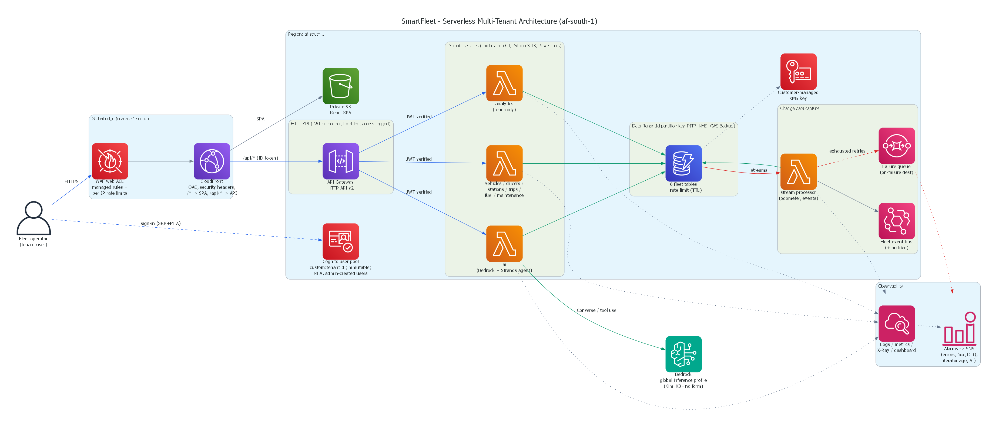

# SmartFleet — SME Fleet & Cash-Flow Platform (South Africa)

SmartFleet is a multi-tenant, serverless fleet-operations and cash-flow platform for South African transport SMEs
(2–50 vehicles). It tracks vehicles, drivers, trips, fuel and maintenance, and derives the numbers an owner-operator
actually runs on: cost per kilometre (R/km), fuel efficiency (L/100km) with anomaly detection, fuel-geofence checks,
and an AI assistant that reads the fleet's own data and can *propose* (never auto-book) maintenance.

Every AWS resource lives in the project Region **`af-south-1`** (Cape Town), except the CloudFront-scope WAF web ACL,
which AWS requires in `us-east-1`. The stack is scale-to-zero: no fixed compute, pay-per-request data.



---

## Table of contents

- [What it does](#what-it-does)
- [Architecture at a glance](#architecture-at-a-glance)
- [Design guarantees](#design-guarantees-each-enforced-by-tests)
- [Technology stack](#technology-stack)
- [Repository layout](#repository-layout)
- [API reference](#api-reference)
- [Local development](#local-development)
- [Testing](#testing)
- [Deployment](#deployment)
- [Configuration](#configuration-stack-parameters)
- [Data you must own](#data-you-must-own)
- [Further documentation](#further-documentation)

---

## What it does

| Area | Capability |
|---|---|
| **Fleet** | CRUD for vehicles, drivers and authorised fuel stations, all scoped to a tenant |
| **Operations** | Trip dispatch and completion as atomic transactions (vehicle + driver locked while on a trip); maintenance workflow with a workshop state machine |
| **Fuel** | Fill-up logging with GPS; full-tank L/100km efficiency; anomaly detection vs. target; geofence verification against the tenant's own stations |
| **Analytics** | Month-to-date cash-flow dashboard, cost-per-km breakdown, fuel efficiency, utilisation, and corridor reference data — all read-only and tenant-scoped |
| **AI assistant** | Amazon Bedrock (via a Strands agent) answers from live fleet data and can *propose* maintenance for human approval; per-tenant rate limits and an operator kill switch |
| **Change data capture** | DynamoDB Streams drive odometer sync and emit domain events (`TripCompleted`, `FuelAnomalyDetected`, `FuelOffGeofence`) with a real failure path |

South African localisation throughout: ZAR (R), kilometres, litres, L/100km, R/km, PrDP and COF tracking.

---

## Architecture at a glance

```
Browser ──HTTPS──▶ CloudFront  (WAF · OAC · security-headers policy)
                     ├── /*       ──▶ private S3 bucket (React SPA)
                     └── /api/*   ──▶ HTTP API v2  (Cognito JWT authorizer · throttled · access-logged)
                                        ├── 8 Lambda services (arm64 · Python 3.13 · Powertools · X-Ray)
                                        │     vehicles · drivers · stations · trips · fuel · maintenance · analytics · ai
                                        └── DynamoDB  (tenantId partition key · PITR · KMS · AWS Backup)
DynamoDB Streams (trips, fuel) ──▶ processor Lambda ──▶ EventBridge bus (+ 30-day archive)
                                        └── exhausted retries ──▶ SQS failure queue ──▶ CloudWatch alarm
ai Lambda ──▶ Amazon Bedrock  (Converse API / Strands agent) via a scoped global inference profile
```

Two companion diagrams in [`docs/architecture/`](docs/architecture): the **CDC & reliability flow**
(`smartfleet-cdc-flow.png`) and the **CI/CD pipeline** (`smartfleet-cicd.png`). All three are regenerated from
[`generate_diagrams.py`](docs/architecture/generate_diagrams.py) (`diagrams` library + Graphviz).

---

## Design guarantees (each enforced by tests)

| Guarantee | How it is enforced |
|---|---|
| **Tenant identity cannot be spoofed** | Tenant = the verified Cognito ID-token claim `custom:tenantId`; the attribute is immutable, admin-assigned and excluded from the app client's write attributes; self sign-up is off; only ID tokens are accepted; no dev headers or default tenant exist anywhere |
| **No cross-tenant access** | Every table key and index is partitioned by `tenantId` (fuel's vehicle index uses `tenantId#vehicleId`); pagination cursors are bound to the tenant; every service has a cross-tenant negative test |
| **No half-applied state** | Dispatch, completion/cancel and workshop transitions are single DynamoDB transactions; a vehicle or driver on a trip is locked against double-dispatch, deletion and manual status changes |
| **Stream failures are never silent** | Handler errors propagate → retry ×3 → bisect batch → SQS on-failure destination → alarm; odometer updates are monotonic/idempotent so replays are safe |
| **No mock, demo or heuristic fallbacks** | AI failures return `503`/`502` with a stable error code; efficiency reports `INSUFFICIENT_DATA` instead of inventing a figure; corridor lookups with no data return `422`; a frontend test fails the build if demo/mock/dev-identity code reappears |
| **AI cannot act on its own** | The agent's only write is creating a `PROPOSED` maintenance record; a human approves it (→ `SCHEDULED`). Tools are bound to one tenant per request; prompts carry aggregates and plates only (POPIA data minimisation) |
| **Least privilege** | One Lambda per domain with per-table IAM; only the `ai` function can call Bedrock, scoped to one inference profile + model via the three-part global-CRIS policy |
| **Safe deploys** | Plan → human approval → execute for production; canary traffic shifting with automatic alarm rollback; stateful resources are `Retain` + deletion-protected |

---

## Technology stack

| Layer | Choice |
|---|---|
| **Compute** | AWS Lambda, arm64 (Graviton), Python 3.13, AWS Lambda Powertools (logging, metrics, tracing) |
| **API** | API Gateway HTTP API (payload v2) with a Cognito JWT authorizer, throttling and access logs |
| **Auth** | Amazon Cognito user pool — SRP sign-in, mandatory TOTP MFA, admin-created users, immutable tenant attribute |
| **Data** | Amazon DynamoDB (on-demand, PITR, SSE-KMS); AWS Backup daily/35-day; a TTL rate-limit table |
| **Events** | DynamoDB Streams → stream-processor Lambda → Amazon EventBridge bus (+ archive); SQS failure queue |
| **AI** | Amazon Bedrock Converse API + Strands Agents SDK; default model **Moonshot Kimi K3** (`global.moonshotai.kimi-k3`) — no model-access form required |
| **Edge / web** | Amazon CloudFront (OAC, response-headers policy, SPA routing function), private S3 bucket, AWS WAF (managed rules + per-IP rate limits) |
| **Observability** | CloudWatch logs (KMS-encrypted, retained), EMF metrics, X-Ray, a dashboard, and alarms wired to an encrypted SNS topic |
| **IaC** | AWS SAM; validated with `sam validate`, cfn-lint and cfn-guard |
| **Frontend** | React 18, Vite, TypeScript, Tailwind CSS, `amazon-cognito-identity-js`; Vitest + Testing Library |
| **CI/CD** | GitHub Actions with OIDC (no long-lived keys), SHA-pinned actions, Dependabot, `pip-audit` + `npm audit` gates |

---

## Repository layout

```
SmartFleet/
├── backend/
│   ├── src/
│   │   ├── vehicles|drivers|stations|trips|fuel|maintenance/  # one Lambda per domain (app.py + models.py)
│   │   ├── analytics/        # read-only analytics endpoints
│   │   ├── ai/               # Bedrock insights + agent endpoints (isolated IAM)
│   │   ├── agent/            # Strands agent + per-tenant tools
│   │   ├── events/           # DynamoDB stream processor (CDC)
│   │   └── shared/           # auth, http, repo, pagination, validation, errors, response,
│   │                         # db, bedrock, ratelimit, geo, corridors, fleet_data,
│   │                         # fleet_metrics, observability, utils
│   ├── layer/                # hash-locked arm64 runtime deps (requirements.in → requirements.txt)
│   └── tests/                # 83 tests; tables built from the SAM template so they match prod
├── frontend/
│   └── src/                  # pages, components, auth (Cognito), services (http/api/auth/config), hooks, tests
├── infrastructure/
│   ├── template.yaml         # the SAM stack (API, auth, data, CDC, edge, alarms, dashboard, backups)
│   ├── waf-cloudfront.yaml   # WAF web ACL (deploy to us-east-1 first)
│   └── samconfig.toml        # dev / staging / prod deploy config
├── scripts/
│   ├── provision_tenant_user.py  # admin-create a tenant user
│   ├── smoke_test.py             # post-deploy smoke test (stdlib only)
│   ├── expand_sam.py             # SAM → CloudFormation for offline linting
│   └── check_compliance.py       # cfn-guard security gate
├── docs/
│   ├── ARCHITECTURE.md                    # full-stack design reference
│   ├── RUNBOOKS.md                        # deploy, onboard, roll back, replay, restore, incident response
│   ├── WELL_ARCHITECTED_REMEDIATION.md    # every review finding, its fix and the proving test
│   └── architecture/                      # PNG diagrams + the script that builds them
└── .github/workflows/deploy.yml           # CI/CD pipeline
```

---

## API reference

All routes require a Cognito **ID token** (`Authorization: Bearer <token>`); the tenant is taken from the token, never
the body or a header. Browsers reach the API same-origin at `/api/*` through CloudFront. Responses are JSON; errors use
`{ "error": { "statusCode", "code", "message" } }`. List endpoints accept `limit` and `nextToken` and return
`{ "items", "nextToken" }`.

| Method | Path | Purpose |
|---|---|---|
| GET/POST | `/vehicles` | List / create vehicles (`?status=`, paginated) |
| GET/PUT/DELETE | `/vehicles/{id}` | Read / update / delete a vehicle |
| GET/POST | `/drivers` | List / create drivers |
| GET/PUT/DELETE | `/drivers/{id}` | Read / update / delete a driver |
| GET/POST | `/stations` | List / create authorised fuel stations |
| PUT/DELETE | `/stations/{id}` | Update / delete a station |
| GET/POST | `/trips` | List / dispatch trips (`?vehicleId=`, `?status=`) |
| GET | `/trips/{id}` | Read a trip |
| POST | `/trips/{id}/end` | Complete a trip (atomic; releases vehicle + driver) |
| POST | `/trips/{id}/cancel` | Cancel an in-progress trip |
| GET/POST | `/fuel` | List / log fuel fill-ups (GPS + price required) |
| GET | `/fuel/summary` | Month-to-date fuel summary |
| GET/DELETE | `/fuel/{id}` | Read / delete a fuel log |
| GET/POST | `/maintenance` | List / create maintenance records |
| GET | `/maintenance/due` | Overdue / due-soon items |
| GET/PUT/DELETE | `/maintenance/{id}` | Read / transition / delete a record |
| GET | `/analytics/dashboard` | MTD financials + overdue alerts |
| GET | `/analytics/costs` | Cost-per-km breakdown per vehicle |
| GET | `/analytics/efficiency` | L/100km vs. target with anomaly status |
| GET | `/analytics/utilisation` | 30-day utilisation per vehicle |
| GET | `/analytics/corridors` | Corridor + station reference data |
| POST | `/analytics/plan-route` | Corridor lookup between two hubs |
| POST | `/analytics/verify-fuel-location` | Geofence check for coordinates |
| POST | `/analytics/ai-insights` | 3 AI cash-flow recommendations (rate-limited) |
| POST | `/agent/chat` | Ask the AI assistant (rate-limited, timeout-bounded) |

See [`docs/ARCHITECTURE.md`](docs/ARCHITECTURE.md) for request/response shapes and status codes.

---

## Local development

```powershell
# Backend — Python 3.12+ locally (Lambda runs 3.13)
python -m venv .venv; .\.venv\Scripts\Activate.ps1
pip install -r backend/requirements-dev.txt
ruff check backend scripts
pytest

# Frontend — there is NO mock backend; point the dev server at a deployed environment
cd frontend
copy .env.example .env.local        # fill in VITE_COGNITO_* and VITE_DEV_PROXY_TARGET from stack outputs
npm ci
npm run dev                         # proxies /api to VITE_DEV_PROXY_TARGET
npm test
npm run build
```

The backend tests create DynamoDB tables (via `moto`) **from `infrastructure/template.yaml`**, so they always run
against the exact keys and indexes production deploys — the schema can't drift from the tests.

---

## Testing

| Suite | Count | Covers |
|---|---|---|
| Backend unit/integration | 83 | Every service, tenant isolation, transactions, CDC failure handling, AI error mapping, rate limiting, and an infrastructure regression guard (`test_template.py`) that locks in the security posture |
| Frontend | 10 | HTTP client (ID token, no tenant header, honest errors, pagination), the login/MFA flow, and a guard test that fails if mock/demo/dev-identity code returns |

```powershell
pytest --cov=backend/src --cov-fail-under=85     # currently ~95%
cd frontend; npm test
```

---

## Deployment

The pipeline (`.github/workflows/deploy.yml`) runs on every PR: `ruff`, backend tests, `sam validate` + cfn-lint +
cfn-guard, dependency audits, and the frontend build/tests. On `main` it deploys **staging automatically**, then creates
a **production change set that waits for human approval** before it is executed (canary traffic shifting with automatic
alarm rollback).

Before the first deploy, work through the one-time checklist in [`docs/RUNBOOKS.md`](docs/RUNBOOKS.md) — confirm the
Region, request a Lambda concurrency increase, create the GitHub OIDC roles and environments, and confirm the alert
mailbox. The WAF stack (`infrastructure/waf-cloudfront.yaml`) deploys to `us-east-1` first; everything else to `af-south-1`.

---

## Configuration (stack parameters)

| Parameter | Default | Notes |
|---|---|---|
| `Stage` | `staging` | `dev` / `staging` / `prod` — toggles canary deploys, deletion protection and backups |
| `AlertEmail` | *(required)* | SNS alarm recipient (confirm the subscription email) |
| `BedrockModelId` | `global.moonshotai.kimi-k3` | Global inference profile; Kimi K3 needs **no** model-access form |
| `BedrockFoundationModelId` | `moonshotai.kimi-k3` | Underlying model, used to scope IAM |
| `BedrockSupportsTemperature` | `false` | `false` for reasoning models (Kimi) that reject `temperature`; `true` for Anthropic/Nova |
| `AiEnabled` | `true` | Operator kill switch for all AI endpoints |
| `AiRateLimitPerMinute` / `PerDay` | `10` / `300` | Per-tenant AI quota |
| `WebAclArn` | `''` | CloudFront WAF ARN (required for prod) |
| `DomainName` / `CertificateArn` | `''` | Optional custom domain + ACM cert (us-east-1) |

To move to an Anthropic or Nova model later, submit its model-access form and set `BedrockModelId`,
`BedrockFoundationModelId` and `BedrockSupportsTemperature=true` — no code change needed.

---

## Data you must own

- **Corridor reference data** (`backend/src/shared/corridors.py`: distances, drive times, Sanral Class 2 tolls) is
  **static and unverified**. Every API response labels it as such; check it against the current Sanral schedule before launch.
- **Authorised fuel stations** are configured **per tenant** (Stations page). Until a tenant adds some, geofence checks
  return `NO_STATIONS_CONFIGURED` rather than guessing.
- **AI data residency**: af-south-1 serves Bedrock only through *global* inference profiles, so prompts may be processed
  outside South Africa. Prompts contain aggregates and vehicle plates only. Get POPIA s72 sign-off or run with `AiEnabled=false`.

---

## Further documentation

- [`docs/ARCHITECTURE.md`](docs/ARCHITECTURE.md) — full-stack design: request lifecycle, data model, CDC, AI agent, security, observability.
- [`docs/RUNBOOKS.md`](docs/RUNBOOKS.md) — operational procedures from first deploy to incident response.
- [`docs/WELL_ARCHITECTED_REMEDIATION.md`](docs/WELL_ARCHITECTED_REMEDIATION.md) — the Well-Architected review findings and how each was fixed.
